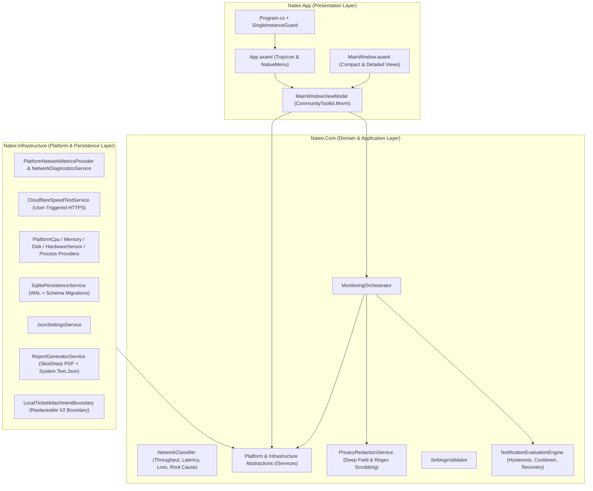

# Natee — Software Architecture (`ARCHITECTURE.md`)

**Natee** (*"Calm monitoring. Clear diagnostics."*) is a cross-platform desktop and system-tray diagnostic application written in C# on .NET 10 LTS (`net10.0`) and Avalonia UI `11.3.22`. Its architecture strictly separates user-interface presentation from core diagnostic logic, operating-system providers, local persistence, and report generation.

---

## 1. High-Level Solution Organization

```text
Natee/
├── Natee.sln
├── Directory.Build.props
├── Directory.Packages.props
├── src/
│   ├── Natee.Core/             # Pure domain models, interfaces, diagnostic rules, notification & privacy engines
│   ├── Natee.Infrastructure/   # OS-specific providers, SQLite repository, SkiaSharp PDF & JSON exporters
│   └── Natee.App/              # Avalonia UI 11.3 presentation, MVVM ViewModels, TrayIcon lifecycle, branding assets
└── tests/
    └── Natee.Tests/            # Automated xUnit unit and integration test suites
```



---

## 2. Project Responsibilities

### 2.1 `Natee.Core`
Contains zero UI or platform-specific library dependencies:
- **Domain Models (`Natee.Core.Models`):** Immutable C# `record` types (`NetworkSnapshot`, `SystemMetricsSnapshot`, `StorageVolumeMetric`, `ProcessResourceMetric`, `DiagnosticCheckItem`, `DiagnosticReport`, `SpeedTestResult`, `AlertNotification`, `PrivacyRedactionOptions`, `NateeSettings`, `TechnicalReportDocument`).
- **Diagnostic & Connectivity Classification (`NetworkClassifier`):**
  - Calculates observed interface throughput (`Mbps`) from byte counter deltas while safely handling counter resets and sub-millisecond intervals.
  - Calculates multi-target average latency and packet loss percentage.
  - Evaluates connectivity health without falsely declaring the entire Internet connection offline when a single remote target drops ICMP packets.
  - Synthesizes evidence-based root-cause summaries (for example, distinguishing a DNS resolution failure over an active IP connection from a local gateway failure).
- **Intelligent Notification Engine (`NotificationEvaluationEngine`):**
  - Evaluates network and system snapshots against user-configured thresholds.
  - Implements consecutive-sample hysteresis (`ConsecutiveSamplesForAlert`), anti-spam cooldown windows (`AlertCooldownSeconds`), suppression of duplicate alerts while a condition remains unchanged, and automatic recovery alerts when a condition clears.
- **Privacy Redaction Engine (`PrivacyRedactionService`):**
  - Scrubs sensitive identifiers (hostname, username, local IPv4/IPv6/gateway, public IPs/DNS, MAC address, adapter names/IDs, Wi-Fi SSID, process names, and local paths) from both structured properties and free-text diagnostic details before any file is written.
- **Monitoring Orchestrator (`MonitoringOrchestrator`):**
  - Coordinates periodic background sampling on a single cancellable background loop (`SemaphoreSlim`-guarded), independent of how many times the dashboard window is opened or closed.

### 2.2 `Natee.Infrastructure`
Implements all `Natee.Core.Interfaces` contracts:
- **Network Providers (`Natee.Infrastructure.Network`):**
  - `PlatformNetworkMetricsProvider`: Queries `NetworkInterface`, `/proc/net/dev`, `/proc/net/route`, and `/etc/resolv.conf`, and probes configured targets using ICMP `Ping` with timed TCP handshake fallback (ports 443/53) when raw ICMP sockets are restricted in unprivileged Linux sessions.
  - `NetworkDiagnosticsService`: Executes the 10-check One-Click Network Diagnosis sequence asynchronously with cancellation and per-step progress reporting.
  - `CloudflareSpeedTestService`: Performs explicit user-initiated HTTPS download and upload speed tests against `speed.cloudflare.com/__down` and `/__up` (or user-configured endpoints).
- **System Providers (`Natee.Infrastructure.SystemMetrics`):**
  - `PlatformCpuMetricsProvider`: Samples `/proc/stat` and `/sys/devices/system/cpu/cpu*/cpufreq/scaling_cur_freq` on Linux, and `GetSystemTimes` (`kernel32.dll`) on Windows. Never confuses nominal base clock with real-time operating frequency.
  - `PlatformMemoryMetricsProvider`: Reads `/proc/meminfo` (`MemTotal`, `MemAvailable`) on Linux and `GlobalMemoryStatusEx` on Windows, measuring strictly physical RAM without mixing swap/pagefile usage.
  - `PlatformHardwareSensorProvider`: Reads non-invasive Linux sysfs thermal sensors (`/sys/class/hwmon/hwmon*` and `/sys/class/thermal/thermal_zone*`), distinguishing `Available`, `TemporarilyInaccessible`, and `Unsupported` states without installing kernel drivers or requiring root privileges.
  - `PlatformDiskMetricsProvider`: Inspects mounted volumes via `DriveInfo.GetDrives()` (filtering out Linux virtual pseudo-filesystems) and calculates disk read/write throughput from `/proc/diskstats` on Linux.
  - `PlatformProcessMonitorProvider`: Reads true OS uptime (`/proc/uptime` / `Environment.TickCount64`) and samples running processes (`Process.GetProcesses()`) to compute CPU utilization normalized across logical cores (`0–100%`) and resident working-set memory.
- **Persistence & Reporting (`Natee.Infrastructure.Persistence`, `Natee.Infrastructure.Reporting`):**
  - `SqlitePersistenceService`: Uses `Microsoft.Data.Sqlite` in WAL mode with a `schema_migrations` table to store and prune diagnostic history, speed tests, and alerts inside the user's local application-data folder.
  - `JsonSettingsService`: Persists validated user settings in `settings.json`.
  - `ReportGeneratorService`: Produces multi-page vector PDF reports via `SkiaSharp` (`SKDocument.CreatePdf`) and formatted JSON reports via `System.Text.Json`.
  - `LocalTicketAttachmentBoundary`: Implements `ITicketIntegrationBoundary` as a clean seam for future Version 2 ticketing integrations (such as Zammad or Jira Service Management).

### 2.3 `Natee.App`
- Built with **Avalonia UI 11.3.22** and **CommunityToolkit.Mvvm 8.4** using compiled bindings (`AvaloniaUseCompiledBindingsByDefault=true`).
- Uses `ShutdownMode.OnExplicitShutdown` so closing the dashboard hides the window to the system tray while background monitoring continues.
- Centralizes user-facing English strings in `Localization/UiStrings.cs` so future Spanish or multi-language localization can be added without modifying business logic.

---

## 3. Data Flow

1. **Background Sampling Loop:** `MonitoringOrchestrator` wakes at `MonitoringIntervalSeconds` (default 3s), invokes network and system providers concurrently, updates cached snapshots, evaluates `NotificationEvaluationEngine`, persists any triggered alerts to SQLite, and raises `MetricsUpdated` marshaled onto the Avalonia UI thread.
2. **One-Click Diagnosis:** User clicks *Diagnose* (in the dashboard or tray menu) -> `MainWindowViewModel.RunNetworkDiagnosisCommand` calls `NetworkDiagnosticsService.RunDiagnosisAsync` with a `CancellationToken` -> results are classified by `NetworkClassifier`, saved to SQLite, and rendered in expandable UI cards.
3. **Report Export:** User reviews privacy checkboxes -> `MonitoringOrchestrator.BuildReportDocument` runs `PrivacyRedactionService.ApplyRedaction` -> `ReportGeneratorService` writes both `.pdf` and `.json` files to the chosen output directory.

---

## 4. Runtime Backend, Memory Profile & Known Architectural Limitations

### 4.1 Linux Windowing Backend (XWayland vs. Native Wayland) & Avalonia 12 Evaluation
- **Linux Windowing & Tray Backend:** On Linux Wayland desktop sessions (verified on Fedora Linux 44 KDE Plasma, `XDG_SESSION_TYPE=wayland`, `WAYLAND_DISPLAY=wayland-0`, `DISPLAY=:0`), `Avalonia.Desktop` initializes `Avalonia.X11.X11Window` running through **XWayland**, while the system tray icon uses the freedesktop.org D-Bus `StatusNotifierItem` protocol (`Avalonia.FreeDesktop` / `Tmds.DBus.Protocol`). Natee does **not** claim native Wayland windowing protocol execution in v1.0.0.
- **Avalonia `11.3.22` vs. `12.1.4` Evaluation:** An isolated build, test, and runtime evaluation of `Avalonia 12.1.4` was performed against `Avalonia 11.3.22`:
  - `Avalonia.Desktop 12.1.4` still depends on `Avalonia.X11` (`Avalonia.X11.X11Window` via XWayland) on Linux and does not introduce a native Wayland backend in `Avalonia.Desktop`.
  - `Avalonia.Skia 12.1.4` upgrades its transitive dependency to `SkiaSharp 3.119.4`, which removes legacy `SKPaint` text-rendering properties used by `SkiaSharp 2.88.9` and increases total resident memory by `~7–14 MB` (`183.09 MB` idle / `207.41 MB` post-diagnosis vs. `175.85 MB` / `193.60 MB` on `11.3.22`).
  - Consequently, Natee v1.0.0 retains **`Avalonia 11.3.22`** for maximum stability, unified `SkiaSharp 2.88.9` native assets, and lower memory overhead.

### 4.2 Measured Memory Footprint, Metric Hierarchy & Deviation from Original Target
Memory consumption was measured on **Fedora Linux 44 (KDE Plasma, x86_64, self-contained `.NET 10.0.12` build)** by reading `GC.GetTotalMemory`, `GC.GetGCMemoryInfo`, `/proc/self/status` (`RssAnon`, `RssFile`, `RssShmem`, `VmRSS`), and `/proc/self/smaps_rollup` (`Private_Dirty`, `Private_Clean`, `Pss`) across both idle monitoring and a complete 10-check diagnostic + report generation cycle:

| Phase | .NET Managed Heap | .NET GC Committed | Anonymous Resident (`RssAnon`) | Private Mapped Pages (`Dirty+Clean`) | Proportional Set Size (`PSS`) | File-Backed Mappings (`RssFile+Shmem`) | Total Resident (`VmRSS`) |
| :--- | :--- | :--- | :--- | :--- | :--- | :--- | :--- |
| **Idle Monitoring** (post-startup GC) | **`4.68 MB`** | `12.80 MB` | **`50.51 MB`** | `124.18 MB` | `131.97 MB` | `125.35 MB` | **`175.85 MB`** |
| **Post-Diagnosis** (before GC) | **`5.86 MB`** | `16.43 MB` | **`61.93 MB`** | `138.32 MB` | `147.13 MB` | `133.63 MB` | **`195.57 MB`** |
| **Post-Diagnosis** (after compacting GC) | **`4.80 MB`** | `14.43 MB` | **`59.97 MB`** | `136.36 MB` | `145.17 MB` | `133.63 MB` | **`193.60 MB`** |

- **How These Metrics Relate (Overlapping Views — Do Not Sum):**
  - The columns above are **not** separate allocations and must never be added together.
  - **Inclusion Hierarchy:** $\text{Managed Heap} \subset \text{GC Committed} \subset \text{RssAnon} \subset \text{Private Mapped Pages} \subset \text{PSS} \subset \text{Total VmRSS}$.
  - **Backing-Store Partition (`/proc/self/status`):** $\text{Total VmRSS} = \text{RssAnon} + (\text{RssFile} + \text{RssShmem})$. During idle monitoring, `50.51 MB` (`RssAnon`) + `125.35 MB` (`RssFile + RssShmem`) = `175.85 MB` (`VmRSS`).
  - **Process-Sharing Partition (`/proc/self/smaps_rollup`):** `Private Mapped Pages` (`124.18 MB` idle / `136.36 MB` post-GC) includes all `RssAnon` pages (`50.51 MB` / `59.97 MB`) **plus** private file-backed pages (`~73.67 MB` / `~76.39 MB`) from Natee's self-contained `.NET 10` DLLs and bundled `libSkiaSharp.so` that no other running process has mapped. The remaining `~51.67 MB` (idle) / `~57.24 MB` (post-GC) of `VmRSS` consists of OS/graphics library pages shared with other processes (`libc`, Mesa/GLX drivers, X11 libraries, and system font caches); `PSS` (`131.97 MB` idle / `145.17 MB` post-GC) adds only Natee's $1/N$ share of those shared pages to `Private Mapped Pages`.
- **Honest Comparison Against Original Performance Target (`~100 MB`):**
  - **Original Target:** Approximately `100 MB` total process resident memory.
  - **Measured Deviation:** Natee **does not meet** the original `~100 MB` total resident memory target. Measured `VmRSS` is **`175.85 MB` during idle monitoring (`+75.85 MB` above target)** and **`193.60 MB` after a complete diagnostic run and garbage collection (`+93.60 MB` above target)** (`PSS` is `131.97 MB` idle and `145.17 MB` post-diagnosis).
  - **Managed Memory vs. Total Process Memory:** Natee's own C# application objects on the `.NET` managed heap consume only **`4.68 MB` idle** and **`4.80 MB` post-diagnosis** (`12.80–14.43 MB` total `.NET` GC committed). The remainder of the process footprint is the fixed native and runtime baseline of a self-contained `.NET 10` + `Avalonia UI` + `SkiaSharp` desktop application (`125.35–133.63 MB` of file-backed runtime assemblies, `libSkiaSharp.so`, HarfBuzz/FreeType font engines, ICU tables, and XWayland/Mesa GPU buffers, plus `~37–45 MB` of non-GC native/CLR/JIT anonymous memory).
- **Evaluation of Memory-Reduction Opportunities:**
  - Application-level allocations are already bounded: speed-test uploads stream in `64 KB` chunks (`SyntheticUploadStream`) rather than allocating multi-megabyte buffers on the Large Object Heap (LOH), and background monitoring reuses compact immutable records.
  - Speculative build changes such as aggressive IL trimming (`PublishTrimmed=true`) or disabling GPU rendering were evaluated and rejected because trimming risks breaking Avalonia XAML/reflection bindings and `System.Text.Json` serialization, while software rendering degrades UI responsiveness without eliminating the core native library mappings.

### 4.3 Platform Limitations
- **Unprivileged Windows CPU Temperature & Real-Time Clock:** Windows does not expose accurate CPU die temperature or dynamic per-core clock scaling to standard unprivileged user-space processes without ring-0 kernel drivers (such as WinRing0, which introduces security vulnerabilities). By design, Natee refuses to install kernel drivers or require Administrator privileges and instead reports `Unsupported` with a clear explanation on Windows.
- **Linux Desktop Environment Tray Protocols:** Avalonia's `TrayIcon` uses the freedesktop.org `StatusNotifierItem` (D-Bus AppIndicator) protocol on Linux. This works out-of-the-box on **Fedora KDE Plasma**, XFCE, MATE, and Cinnamon, whereas vanilla GNOME requires the `gnome-shell-extension-appindicator` package to display system tray icons. Natee always opens its main dashboard window on launch so users on unconfigured GNOME desktops can still use the application.
